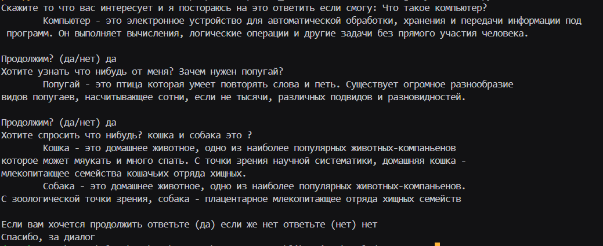
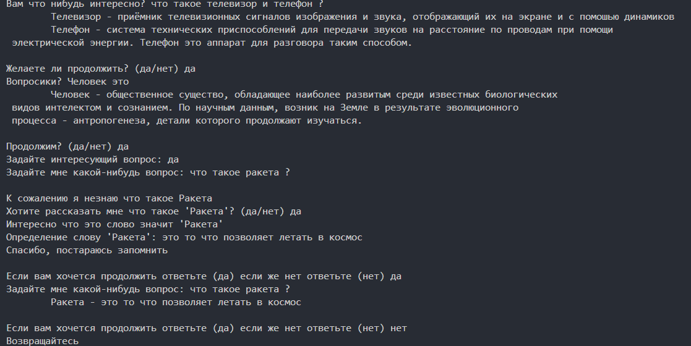
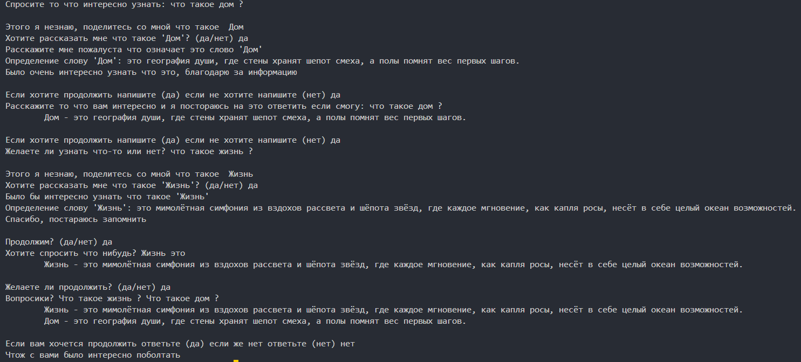

# 📚 Умный библиотекарь — система управления знаниями

Консольное приложение для работы с базой знаний: понимает вопросы на естественном языке, обучается на ответах пользователя и сохраняет информацию между сеансами.



## 📖 Возможности

- 🧠 **Понимает** вопросы на естественном языке: «что такое телефон?»
- 💬 **Отвечает** определениями из базы знаний
- 📚 **Обучается** — если не знает слово, спрашивает пользователя и запоминает
- 💾 **Сохраняет** данные между сеансами (JSON)
- 🎯 **Фильтрует** «слова-конструкторы» («что», «такое», «как») — оставляет только суть
- 🧩 **Модульная архитектура** — чёткое разделение логики

## 💡 Примеры использования

**Пользователь**: Что такое телефон?  
**Библиотекарь**: Телефон — система технических приспособлений для передачи звуков на расстояние по проводам...

**Пользователь**: Что такое ИИ?  
**Библиотекарь**: Я не знаю что такое ИИ, поделитесь со мной что такое ИИ.

**Пользователь**: да  
**Библиотекарь**: Тогда дайте определение этому слову.  
**Пользователь**: ИИ - это искусственный интеллект.  
**Библиотекарь**: Спасибо, постараюсь запомнить.

**Пользователь**: Что такое ИИ?  
**Библиотекарь**: ИИ — это искусственный интеллект. *(система запомнила!)*

## 🛠 Установка и запуск

### 1. Клонировать репозиторий

```bash
git clone https://github.com/Lloydcodes25/librarian.git
cd librarian
```

### 2. Создать виртуальное окружение (опционально)

```bash
python -m venv venv

# Linux / Mac
source venv/bin/activate

# Windows
venv\Scripts\activate
```

### 3. Инициализировать данные (один раз)

```bash
python create_object.py
```

> Создаёт `library.json` (база знаний) и `fillers.json` (слова-конструкторы).

### 4. Запустить

```bash
python main.py
```

> ⚠️ **Важно**: запускай `init_data.py` **один раз**. Если запустишь **после** того, как система чему-то научилась — **новые данные сотрутся**.

## 📸 Скриншоты





## 📁 Структура проекта

```
librarian/
├── images/                  # скриншоты
│   ├── image_001.png
│   ├── image_002.png
│   └── image_003.png
├── .gitignore
├── README.md
├── requirements.txt         # пустой (без зависимостей)
├── init_data.py             # создание данных (запуск один раз)
├── main.py                  # точка входа
├── random_msgs.py           # случайные фразы
├── library.json             # база знаний (создаётся)
└── fillers.json             # слова-конструкторы (создаётся)
```

## 🧠 Как это работает

1. **main.py** — главный цикл: спрашивает вопрос, обрабатывает ответ.
2. **extract_keywords** — нормализует текст, убирает «слова-конструкторы», ключевые слова слнеизвестныеестные**.
3. **find_definitions** — ищет ключевых словчевых слов** в JSON.
4. **learn_new_words** — для **неизвестныопределениевает **определениесохраняеттеля random_msgs.
5. **random_msgs** — разнообразнне повторялсяот **не повторялся**.

## 📄 Лицензия

MIT


